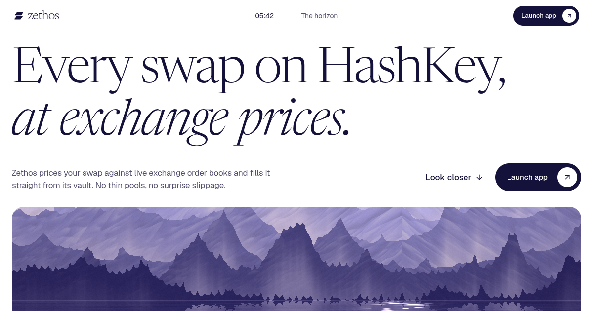

<p align="center">
  <a href="https://zethos-mainnet.vercel.app">
    
  </a>
</p>

<h1 align="center">Zethos</h1>

<p align="center">
  <strong>The AI trading desk for token projects on HashKey Chain, inside limits the founder sets and the AI can't break.</strong>
</p>

<p align="center">
  <a href="https://zethos-mainnet.vercel.app"><strong>Mainnet app</strong></a> ·
  <a href="https://zethos-jade.vercel.app"><strong>Testnet app</strong></a> ·
  <a href="#deployments">Deployments</a> ·
  <a href="#how-it-works">How it works</a> ·
  <a href="#run-it-locally">Run it locally</a>
</p>

---

## The problem

Thin on-chain liquidity gives HSK swaps worse prices than exchanges show. The usual fix is a market maker, and that creates three gaps for a token project:

- **Hidden strategy.** The pricing logic is private.
- **Unexplained losses.** A loss arrives as a number, with no cause.
- **No control.** A new strategy can go live without review.

**Zethos replaces that black box with a written mandate, a price anyone can check, and a record of every decision.**

## How it works

Zethos prices swaps from live exchange order books and fills them from its own vault on HashKey Chain.

- **Checkable prices.** Every quote is a signed, firm offer. The client verifies it, then the vault verifies it again.
- **AI outside the pricing path.** The AI proposes strategies offline, as data. They must pass tests on data it never saw.
- **Hard limits.** The mandate applies after a strategy decides and before anything is signed.

<p align="center">
  
</p>

1. **Prices.** The engine polls exchanges every 2 seconds and fuses one weighted book per pair.
2. **Request.** A client asks for a quote through the web app, SDK or MCP server.
3. **Signed quote.** Policy and mandate run, then a firm EIP-712 quote is stored and returned. The client verifies it.
4. **Fill.** The taker's wallet calls `fill(quote, signature)`. The vault re-checks and settles both legs or reverts.
5. **Record.** A watcher reads `Fill` events into the engine's records.
6. **Diagnose.** Losses get a cause, and the offline research agent reads the diagnosis.
7. **Improve.** A qualified candidate is registered with its report and can take a small canary share.

Three independent checks guard every quote: mandate, client and vault. None has to trust the others.

## Deployments

> [!NOTE]
> **Deployment is complete on mainnet and testnet.** Contracts, engines and web apps are all running.
>
> **I recommend testing on testnet first.** Fills settle on-chain there, with test tokens that have no market value. See [Test it on testnet](#test-it-on-testnet).

| | Mainnet | Testnet |
|---|---|---|
| **Status** | Deployed | Deployed (recommended for testing) |
| **Chain ID** | `177` | `133` |
| **App** | [zethos-mainnet.vercel.app](https://zethos-mainnet.vercel.app) | [zethos-jade.vercel.app](https://zethos-jade.vercel.app) |
| **Engine API** | [zethos-engine-mainnet…workers.dev](https://zethos-engine-mainnet.divyamsingh-dev.workers.dev/status) | [zethos-engine-testnet…workers.dev](https://zethos-engine-testnet.divyamsingh-dev.workers.dev/status) |
| **Settlement** | Paper (`shadow` mode) | On-chain (`live` mode) |
| **Vault** | Verified, no inventory | Verified, funded with test tokens |
| **Tokens** | USDT, WHSK, WETH | tUSDT, tWHSK, tWETH |
| **Explorer** | [hsk.blockscout.com](https://hsk.blockscout.com) | [testnet-explorer.hskchain.net](https://testnet-explorer.hskchain.net) |

Both price from live exchange order books and share no database, keys or tokens. `GET /status` reports each engine's mode, routes and feed health.

### Contract addresses

| Network | Contract | Address |
|---|---|---|
| Mainnet | **ZethosVault** (full match) | [`0x1e6c7fBCd245A1a4FA8aBaDf57dF1ECf2E1A2aAF`](https://hsk.blockscout.com/address/0x1e6c7fBCd245A1a4FA8aBaDf57dF1ECf2E1A2aAF) |
| Mainnet | USDT | [`0xF1B50eD67A9e2CC94Ad3c477779E2d4cBfFf9029`](https://hsk.blockscout.com/address/0xF1B50eD67A9e2CC94Ad3c477779E2d4cBfFf9029) |
| Mainnet | WHSK | [`0xB210D2120d57b758EE163cFfb43e73728c471Cf1`](https://hsk.blockscout.com/address/0xB210D2120d57b758EE163cFfb43e73728c471Cf1) |
| Mainnet | WETH | [`0xefd4bC9afD210517803f293ABABd701CaeeCdfd0`](https://hsk.blockscout.com/address/0xefd4bC9afD210517803f293ABABd701CaeeCdfd0) |
| Testnet | **ZethosVault** (partial match) | [`0x8deB013d7A8f5f5C6C2d8fb12506fab506721d01`](https://testnet-explorer.hskchain.net/address/0x8deB013d7A8f5f5C6C2d8fb12506fab506721d01) |

Real settlement: [5 tUSDT for 0.00219 tWETH through the testnet vault](https://testnet-explorer.hskchain.net/tx/0x4958b455b420dc03c367673ebaeea7d26088c479c6bf3ffbe9f908fcceb6c4c4).

### Custom test tokens

I deployed these on testnet only. They have no market value, and the mainnet tokens above are existing HashKey Chain tokens.

| Token | Name | Decimals | Address | Source | Deploy tx |
|---|---|---|---|---|---|
| **tUSDT** | Zethos Test USDT | 6 | [`0x1095085CAf22cEEa130f73a99234dd2C9216fb72`](https://testnet-explorer.hskchain.net/address/0x1095085CAf22cEEa130f73a99234dd2C9216fb72) | Verified | [`0xc11a…7f0d`](https://testnet-explorer.hskchain.net/tx/0xc11a1b96ceb41decab118d738a0e1018a7c1e9fa8be7a89088263a9ff4ee7f0d) |
| **tWHSK** | Zethos Test WHSK | 18 | [`0x60786f25Ae5dEef658dd1Da2F62dd6e7c7674716`](https://testnet-explorer.hskchain.net/address/0x60786f25Ae5dEef658dd1Da2F62dd6e7c7674716) | Not verified | [`0x13a1…f4c4`](https://testnet-explorer.hskchain.net/tx/0x13a11921d93c662a0093007032181de5d7d188c73c4fb3e3f8bbc56f2f3ff4c4) |
| **tWETH** | Zethos Test WETH | 18 | [`0x6ab12f10d4f0ef5B3faae774abb724A958f5BD80`](https://testnet-explorer.hskchain.net/address/0x6ab12f10d4f0ef5B3faae774abb724A958f5BD80) | Verified | [`0x04d3…835c`](https://testnet-explorer.hskchain.net/tx/0x04d3ddebc331b8e808169f7a7c64e03a8e2edadbe8435dc7312ca69bec2b835c) |

### Test it on testnet

Open the [testnet app](https://zethos-jade.vercel.app) and connect a wallet on chain `133` (RPC `https://testnet.hsk.xyz`).

**UI**

1. **`/desk`:** get a signed quote, then run the refusal presets.
2. **`/agent`:** try `quote 500 usdt of hsk`, then `Buy 500 USDT of HSK, max 1 bps` to watch the guard refuse.
3. **`/arena`:** launch a paper attack. No wallet needed.
4. **Settle from wallet:** fill from `/desk` or `/agent`, then open the transaction. This needs testnet HSK for gas and owner-minted test tokens, so ask me for an allocation.

**Contracts**

- Read the [verified vault source](https://testnet-explorer.hskchain.net/address/0x8deB013d7A8f5f5C6C2d8fb12506fab506721d01) and its `Fill` events.
- Review the [on-chain test results](packages/contracts/README.md#on-chain-test-results): fills, replays, expiry, caps, bad signatures, pausing and withdrawals.
- Run the vault suite with `bun run contracts:test`.

## Key features

What you can do with it:

- **Founders:** review the mandate, test it with real quotes, see each loss explained, and review strategies before they run.
- **Traders:** swap at exchange-based prices, or type a trade in plain English with a hard cost limit.
- **Vault owners:** pause and resume quoting, track P&L, and read every decision.
- **Developers and AI agents:** integrate through the SDK or MCP server, and verify every quote locally.
- **Anyone:** attack the desk on paper, compare prices with on-chain liquidity, and check fills on the explorer.

| Screen | Route | For | What it does | Why it exists |
|---|---|---|---|---|
| **Overview** | `/dashboard` | Everyone | Shows prices, performance, vault, missions, takers, fills, decisions | See the desk's health in one place |
| **Agent** | `/agent` | Traders | Turns plain English into bounded trades | Trade without learning a trading screen, and never pay over your limit |
| **Swap** | `/app` | Traders | Familiar swap form on the same quotes and checks | Direct trading for anyone who doesn't want an agent |
| **Arena** | `/arena` | Everyone | Paper trading and attacks on live prices | Stress the desk with no tokens at risk |
| **Insights** | `/stats` | Everyone | Compares exchange prices with on-chain liquidity | Show the price gap and let visitors verify the sources |
| **Research** | `/research` | Founders | Shows strategy pipeline, specs, reports, verdicts | Review why a strategy passed or failed |
| **Desk** | `/desk` | Founders | Shows the mandate and tests real quotes | Prove the limits hold before trusting the desk |
| **Workspace** | `/operator` | Vault owner | Shows P&L and holds the controls | Give the owner a stop switch and full view |

### Landing page

**Purpose:** explain Zethos to a new visitor and show why exchange-based pricing matters.

Lives at `/`. Drag a trade from $100 to $25K and see where a thin pool falls behind a flat spread. Also breaks down a quote, the safety checks and a fill.

### Across the app

**Purpose:** make every screen fast to reach and every result easy to trust.

- **Wallets:** browser wallets and WalletConnect.
- **Command palette:** `Ctrl/Cmd + K` opens pages or the wallet, stops all missions, or sends a sentence to the Agent.
- **Shortcuts:** `g` plus a page's key navigates. `[` toggles the sidebar.
- **Clean results:** paper and on-chain results stay separate, and sample data is labelled. Engine failures stay errors, and halted pairs can't quote.

### Desk

**Purpose:** let a founder see the limits on their inventory and test them with real quotes before trusting the desk.

- **Mandate:** HSK/USDT and ETH/USDT, a 15% to 85% inventory band around 50%, maximum spread by size, a $25,000 operating-loss limit and a 99% uptime target.
- **Test the desk:** pick pair, side and amount for a signed quote showing pay, receive, price and cost against mid.
- **Breakdowns:** where the price came from, how the spread was built, what was checked.
- **Five checks:** pair in mandate, spread in limit, size in route cap, vault not paused, signature matches the on-chain signer.
- **Refusal presets:** Over the route cap and Under the minimum trigger real refusals, with reasons.
- **Settle from wallet:** on a live engine, fill from your wallet and see the transaction link and new balances.
- **Compliance:** active policies and live figures against the mandate.

### Agent

**Purpose:** let anyone trade in plain English with a hard cost limit, without giving a model control of prices or transactions.

Type an instruction, then authorize the draft. Common requests parse locally. Broader English goes through Gemini to a validated plan. The model never supplies prices or transaction data, and anything unclear is refused, not guessed.

| Capability | Example | Behaviour |
|---|---|---|
| Trade | `Buy 500 USDT of HSK`, `sell 0.1 ETH` | Compiles to a draft you authorize |
| Cost limit | `max 40 bps`, `within 0.5%` | Default 1.5%. Over the limit: held up to 60 seconds, then refused |
| Splitting | `over 2 minutes`, `in 4 slices` | 2 to 20 slices, at most an hour |
| Trigger | `if it drops 1%`, `when hsk is below 0.08` | Waits 15 minutes by default, or as set |
| Dry run | `quote 500 usdt of hsk` | Real signed price, never settles |

Every mission shows six stages: **Sense**, **Price**, **Verify**, **Guard**, **Settle**, **Measure**. **My position** separates holdings by settlement type, and any mission can be stopped.

### Swap

**Purpose:** give traders a direct route to the same signed quotes and safety checks, with no agent involved.

Token picker, quote review that explains the price, preferences and recent swaps.

### Overview

**Purpose:** show the whole desk at a glance.

Prices, performance, vault, missions, takers, fills and decisions, driven by a live stream that can only refresh the display and can never trigger a trade.

### Insights

**Purpose:** show the gap between exchange prices and on-chain liquidity, and what a visitor can verify.

Lists each exchange source beside on-chain liquidity. No configured venue means zero depth, never an invented price or savings figure.

### Arena

**Purpose:** test how the desk prices honest and hostile flow, with no tokens at risk and every number open to inspection.

Paper trades run through the real pricing code on live prices, always labelled paper.

- **Exchange tape:** samples 5% of real trades and paper-fills them when the desk's quote beats the trade.
- **Attacks:** Naive, Sniper and Rotating bots run up to 60 seconds with no wallet or token movement. `apps/sniper` adds Latecomer and records runs as scenarios.
- **Accounting:** P&L split into spread and inventory, plus profit by flow after five-minute markouts.
- **Real vault fills:** listed apart with explorer links, never in paper totals.

### Research

**Purpose:** improve the desk's strategy from its own losses, while keeping the AI away from live prices.

Runs offline, so a slow or failing model can't touch a live quote.

1. **Diagnose.** Attribute losses to stale reference, inventory imbalance, selective execution or adverse size, in dollars, with example fills.
2. **Propose.** Gemini writes a strategy as validated JSON from 3 price references and 9 spread terms. Never code.
3. **Qualify.** Replay against the incumbent on development, attack and held-out data. The research path fails closed before reading held-out data.
4. **Canary.** Take a small share of requests, then get promoted or retired on results.

| Gate | Rule |
|---|---|
| Held-out data | Beat or match the incumbent |
| Drawdown | At most 1% worse |
| Honest fills | At most 5% worse, at least 50% overall |
| Rejections | At most 50%, so refusing everything fails |
| Canary share | At most 10% of requests |
| Promotion | At least 100 fills |
| Retirement | 2% drawdown or a 20% fill-rate drop |

Reports bind to the hash of the exact spec, and the registry refuses a spec without one. Prompts, responses and reports are saved in `apps/engine/research-runs/` with keys redacted. Both deployments run incumbent `p-20261101-f392cc66` at 100%.

### Workspace

**Purpose:** give the vault owner direct oversight and a way to stop quoting.

Owner-only, through wallet sign-in (SIWE). Shows P&L, feeds, inventory and the journal. Pauses and resumes quoting and starts paper epochs. The operator API also sets taker tiers and flow labels.

## Core systems

### Engine

**Purpose:** turn live market data into firm, signed prices that stay inside the mandate.

Hono on Cloudflare Workers. One Durable Object holds prices and inventory in memory, so nonce and inventory checks can't race.

| Component | What it does | Why it exists |
|---|---|---|
| **Feed fusion** | Weights up to 4 venues per pair, halts a pair when feeds fail | No single exchange sets the price, and bad data stops quoting |
| **Pricing** | Builds spreads from named terms | Every part of a price can be explained |
| **Taker scoring** | Scores behaviour, never labels. New addresses start on probation, `watch` and `toxic` get wider spreads, shorter quotes and smaller sizes, `blocked` gets no quotes | Informed traders pay for the risk they bring, not the desk's inventory |
| **Markouts** | Measure fills at 1, 5, 30 and 300 seconds | Show whether a fill was good, and drive the spread tuner and P&L by flow |
| **Risk gates** | Watch drawdown, feed outages, markout alarms and inventory | Halt quoting automatically when conditions turn bad |
| **Mandate layer** | Rejects breaches, journaled as `mandate_breach` | No strategy can step outside the founder's limits |
| **Decision journal** | Records registrations, qualifications, breaches, diagnoses and promotions, with inputs and reason. Gemini can narrate, but decisions stay deterministic | Every decision can be audited later |
| **Strategy registry** | Stores strategies with their reports, and runs canary, promotion and retirement | Only tested strategies can run |
| **Persistence** | Commits each paper fill, nonce and inventory change in one transaction, and reconciles after a crash | Records stay consistent through failures |
| **Replay** | Serves a recorded market offline, labelled `paper-replay` | Makes tests and research repeatable |

| Access | Endpoints |
|---|---|
| Market | `GET /health` · `/status` · `/stats` · `WS /stream` |
| Trading | `POST /quote` · `/arena/quote` · `/paper/fill` · `GET /fills` |
| Desk and research | `GET /mandate` · `/desk/compliance` · `/diagnosis` · `/policies` · `/decisions` · `/arena` · `/arena/takers` · `POST /chat` |
| Sign-in | `/auth/nonce` · `/auth/verify` · `/auth/logout` |
| Vault owner | `GET /pnl` · `POST /operator/pause` · `/operator/resume` · `/operator/taker-tier` · `/operator/labels` · `/operator/arena-reset` |
| Admin token | `POST /policies` · `/policies/:id/canary` · `/policies/:id/promote` · `/policies/:id/retire` |

### ZethosVault

**Purpose:** hold inventory and have the final say on every trade, so a taker never has to trust the engine.

The engine proposes prices. [The contract](packages/contracts/README.md) decides whether a trade is allowed.

- **Fill checks:** caller, signature, expiry, validity window, single-use nonce, pause, route, amounts, size cap, optional pool price, inventory.
- **Three enforced roles:** owner controls funds and configuration, quote signer only signs, executor only pauses.
- **Safe failure:** withdrawals work while paused, so a pause can't trap funds.
- **Atomic settlement:** exact signed amounts move together or not at all, once per nonce, for that taker, before expiry.

### SDK

**Purpose:** let other apps use the desk without trusting the engine's word for a quote.

[`@zethos/sdk`](packages/sdk/README.md) runs in browsers, Bun and Node 20+. It checks signature, bindings, bounds, expiry and price protection locally before any fill.

### MCP server

**Purpose:** let AI agents read markets and trade through Zethos under hard limits, without holding keys.

[The server](apps/mcp/README.md) runs over stdio or Streamable HTTP, with tools for markets, quotes, verification, swaps, fills, decisions and Arena stats. It holds no private keys, enforces per-swap and daily limits, and returns unsigned calldata in live mode.

### Attacker bots

**Purpose:** generate hostile flow and turn it into test data for strategies.

[`apps/sniper`](apps/sniper/README.md) runs Naive, Sniper, Latecomer and Rotating bots on paper, through public endpoints with no keys. Its recorder saves runs as replayable scenarios for the evaluator.

## Tech stack

| Layer | Tools |
|---|---|
| Web | Next.js · Tailwind CSS · wagmi · viem · Recharts · Vercel |
| Engine | Hono · Cloudflare Workers · Durable Objects · Drizzle · Neon Postgres · Zod |
| Contracts | Solidity 0.8.24 · Foundry · OpenZeppelin 5.7 · HashKey Chain |
| AI | Gemini API · Model Context Protocol |
| Market data | Public APIs from HashKey Global, Gate, KuCoin, MEXC, OKX and Binance |
| Standards | EIP-712 quotes · Sign-In with Ethereum · WalletConnect |
| Tooling | Turborepo · Bun · TypeScript · Biome |

## Deliverables

| Item | Where |
|---|---|
| AI agent for trading | [Agent](#agent) and [Research](#research) |
| Live on HashKey Chain | [Mainnet and testnet deployments](#deployments) |
| Verified vaults | [Contract addresses](#contract-addresses) |
| On-chain settlement | [Testnet transaction](https://testnet-explorer.hskchain.net/tx/0x4958b455b420dc03c367673ebaeea7d26088c479c6bf3ffbe9f908fcceb6c4c4) |
| Source code | [github.com/divyyyam/zethos](https://github.com/divyyyam/zethos) |
| Tests | 704 passing, see [Run it locally](#run-it-locally) |

## Security model

- **No LLM in the pricing path.** Strategies are validated, hashed and compiled deterministically.
- **Mandate outside the strategy.** Enforced after it decides, before anything is signed.
- **Held-out data kept apart** from the research path.
- **Self-custody settlement.** Users fill from their own wallets. The engine never holds their keys.

| Limit | Current state |
|---|---|
| Audit | Vault not independently audited |
| Mainnet settlement | Paper only. Live mode is restricted to chain `133`, and the mainnet vault holds no inventory |
| Signer key | A stolen quote-signer key could drain inventory one capped fill at a time until paused or rotated |
| Uptime | 99% is a mandate target, not a measured figure |
| Hedging | None |
| Attack results | Arena is paper and some scenario data is synthetic, so results don't prove protection |
| Feeds | Binance is unreachable from Cloudflare, so hosted ETH/USDT uses OKX and HashKey Global |

## Run it locally

Requires [Bun](https://bun.sh) 1.4.2 and [Foundry](https://getfoundry.sh).

```sh
bun install
bun run contracts:install
cp apps/web/.env.example apps/web/.env.local
cp apps/engine/.dev.vars.example apps/engine/.dev.vars
bun run dev                 # web on :3000, engine on :8787
```

The engine starts in paper mode with an in-memory store, so no database is needed.

```sh
bun run typecheck && bun run lint && bun run test
```

704 tests: 280 engine, 167 web, 116 SDK, 90 vault (with fuzz and solvency invariants), 38 attacker bots, 13 MCP.

Research cycle:

```sh
cd apps/engine
ENGINE_URL=https://<engine> GEMINI_API_KEY=... ADMIN_TOKEN=... \
  bun scripts/research-cycle.ts --date=YYYYMMDD --incumbent=v0 --pair=HSK/USDT
```

Paper attacker:

```sh
ZETHOS_ENGINE_URL=http://localhost:8787 bun apps/sniper/src/index.ts --mode sniper --pair HSK/USDT
```

## Repository

| Path | Contents |
|---|---|
| [`apps/engine`](apps/engine/README.md) | Feeds, pricing, mandate, registry, diagnosis, journal, API, research CLI |
| [`apps/web`](apps/web/INTEGRATION.md) | Landing page and the eight product screens |
| [`apps/mcp`](apps/mcp/README.md) | MCP server for AI agents |
| [`apps/sniper`](apps/sniper/README.md) | Paper attacker bots and scenario recorder |
| [`packages/contracts`](packages/contracts/README.md) | `ZethosVault`, with unit, fuzz and invariant tests |
| [`packages/sdk`](packages/sdk/README.md) | TypeScript client with local quote verification |
| `packages/shared` | Chains, addresses, EIP-712 types, generated ABIs |


**Note:** MCP and SDK integrations have been scaffolded but remain out of scope for the current implementation. They are reserved for potential future development. convert this into a super baller pitch and give me to the point lines for this